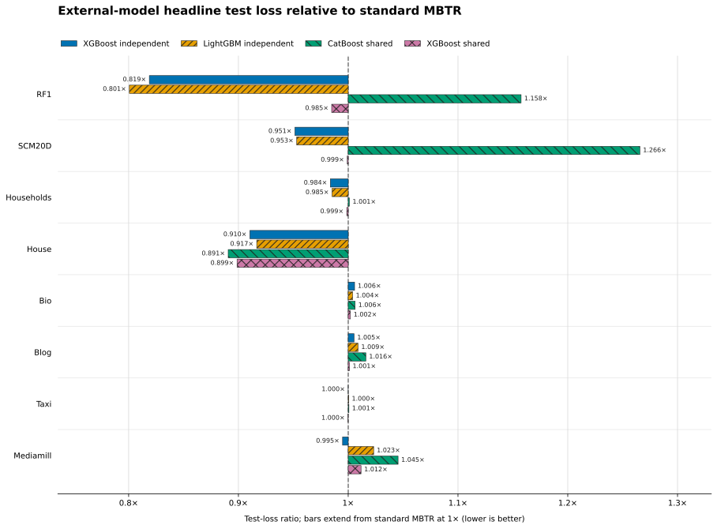
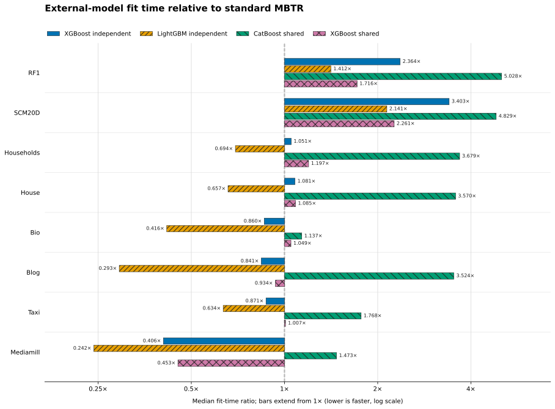

# MBTR

MBTR fits gradient-boosted trees with multivariate and structured responses,
including shared-tree multilabel classification. Unlike fitting one independent
model per output, a leaf may use a coupled response: a smoothed vector, a
Fourier basis, a latent linear map, a set of quantiles, a ridge-linear model, or
a vector of Bernoulli-logit updates.

The v0.2 implementation defines explicit contracts for split construction,
optional post-structure refitting, and reported metrics, enforces tree-size
invariants, and provides a compact scikit-learn-style estimator interface.

## What's new in v0.2.0

This release substantially improves correctness, usability, and performance:

- Corrects split-gain, partition, minimum-leaf, validation, Fourier, and
  structured-objective defects while preserving the published hybrid quantile
  fitting strategy.
- Introduces the scikit-learn-style `MBTRegressor` and the new binary/multilabel
  `MBTClassifier`, including constant, ridge-linear, and linear-logistic leaf
  responses with validation-based early stopping.
- Adds verified NumPy and optional Numba engines, batched histogram split
  search, sibling-histogram reuse, compact trees, and faster prediction.
  Controlled multivariate benchmarks show standard-fit speedups of up to about
  `10×` with essentially unchanged predictive quality.
- Expands automated tests, serialization checks, reproducible performance and
  scientific benchmarks, examples, migration guidance, and API documentation.

`MBT` and legacy parameter names remain available for one transition cycle.
Previously saved v0.1 models should be retrained; see the
[migration guide](https://github.com/supsi-dacd-isaac/mbtr/blob/master/docs/source/migration.rst).

## Installation

Install the core NumPy/SciPy implementation:

```bash
python -m pip install mbtr
```

Optional dependencies are grouped by purpose:

```bash
python -m pip install "mbtr[fast]"       # optional acceleration dependencies
python -m pip install "mbtr[plot]"       # plotting and NetworkX export
python -m pip install "mbtr[examples]"   # external dataset examples
```

For a development checkout, use `python -m pip install -e ".[dev,test,docs,benchmark]"`.

## Offline quickstart

This example is deterministic and does not download data:

```python
import numpy as np

from mbtr import MBTRegressor

rng = np.random.default_rng(7)
X = rng.normal(size=(600, 6))
Y = np.column_stack(
    (
        2.0 * X[:, 0] - X[:, 1],
        X[:, 0] + 0.5 * X[:, 2],
        -X[:, 1] + X[:, 3],
    )
) + 0.1 * rng.normal(size=(600, 3))

X_train, X_test = X[:500], X[500:]
Y_train, Y_test = Y[:500], Y[500:]

model = MBTRegressor(
    objective="squared_error",
    n_estimators=50,
    learning_rate=0.08,
    max_bins=32,
    min_samples_leaf=15,
    max_depth=4,
    random_state=7,
)
model.fit(X_train, Y_train)
Y_pred = model.predict(X_test)

print(Y_pred.shape)       # (100, 3)
print(model.score(X_test, Y_test))
```

Use an explicit validation set for early stopping:

```python
model = MBTRegressor(
    n_estimators=300,
    early_stopping_rounds=20,
    random_state=7,
)
model.fit(X[:400], Y[:400], eval_set=(X[400:500], Y[400:500]))

print(model.best_iteration_)
print(model.evals_result_["validation"])
```

For chronological data, always construct an explicit time-ordered validation
set. `validation_fraction` performs a seeded random split and is not suitable
for forecasting unless random validation is scientifically justified.

## Binary and multilabel classification

`MBTClassifier` accepts either a one-dimensional binary target or a
two-dimensional `0`/`1` multilabel indicator matrix. Tree partitions are shared
across labels. Without a response design, each leaf returns one constant logit
update per label; probabilities and hard labels are produced only after the
ensemble logits are passed through the sigmoid and decision threshold:

```python
from mbtr import MBTClassifier

labels = np.column_stack(
    (
        X[:, 0] + X[:, 1] > 0.0,
        X[:, 1] - X[:, 2] > 0.25,
        X[:, 0] * X[:, 3] > 0.0,
    )
).astype(int)

classifier = MBTClassifier(
    n_estimators=50,
    learning_rate=0.08,
    max_depth=4,
    decision_threshold=0.5,
    random_state=7,
)
classifier.fit(X[:500], labels[:500])
probability = classifier.predict_proba(X[500:])
prediction = classifier.predict(X[500:])

print(probability.shape)  # (100, 3), positive-label probabilities
print(classifier.score(X[500:], labels[500:]))  # exact/subset accuracy
```

For a one-dimensional binary target, `predict_proba` follows the usual
two-column `(P(class=0), P(class=1))` convention. For a multilabel target it
returns one positive-label probability per output. `decision_function` exposes
the corresponding raw logits, and `evals_result_` records mean binary
cross-entropy.

The Bernoulli objective evaluates its loss, gradient, and curvature without
subtracting probabilities that have rounded to one. This applies the numerical
principle in Barron, Gnanapragasam, and Tschannen's
[“A Fix for Softmax and Cross-Entropy”](https://arxiv.org/abs/2610.31642) to the
binary case. The current classifier does not use softmax and does not yet accept
multiclass targets. A future grouped-softmax implementation will require block
Hessians and the paper's target-excluded, zero-sum construction.

Supplying `response_features` selects linear-logistic leaves. Each leaf then
fits one ridge-logit update per label as a linear function of the supplied
design, with an intercept added internally. The original `X` still controls
tree routing, so the split matrix and the within-leaf design can be different:

```python
linear_classifier = MBTClassifier(
    n_estimators=50,
    linear_response_curvature="upper_bound",
    l2_regularization=1e-3,
    random_state=7,
)
linear_classifier.fit(
    X[:500],
    labels[:500],
    response_features=X[:500, :3],
)
probability = linear_classifier.predict_proba(
    X[500:],
    response_features=X[500:, :3],
)
```

The default `linear_response_curvature="upper_bound"` uses the global
Bernoulli curvature bound `1/4`, allowing all labels to share one design Gram
matrix. `"exact"` instead builds a probability-weighted Gram matrix for every
label and boosting round. It can fit the local Newton geometry more closely,
but its time and temporary-memory costs grow with both the number of labels and
the square of the response-design width. The default therefore has roughly the
same matrix order as linear-response regression. Set
`regularize_intercept=True` only when the intercept should receive the ridge
penalty too.

## Structured objectives

| Objective | Required configuration | Prediction shape |
|---|---|---|
| `squared_error` (`mse`) | none | `(samples, outputs)` |
| `time_smoother` | `lambda_smooth` | `(samples, outputs)` |
| `fourier` | `n_harmonics` | `(samples, outputs)` |
| `latent_variable` | `S`, `precision` | `(samples, outputs)` |
| `linear_regression` | `response_features` in `fit` and `predict` | `(samples, outputs)` |
| `quantile` | ordered `alphas`; optional `smoothing` | `(samples, outputs, quantiles)` |
| `quadratic_quantile` | ordered `alphas`; optional `quadratic_scale`, `denominator_floor` | `(samples, outputs, quantiles)` |
| `pseudo_huber_quantile` | ordered `alphas`; optional `delta` | `(samples, outputs, quantiles)` |

Objective-specific settings belong in `objective_params`:

```python
smooth_model = MBTRegressor(
    objective="time_smoother",
    objective_params={"lambda_smooth": 2.0},
)
```

The two published quantile objectives deliberately separate tree construction
from the statistical target. `quantile` uses logistic-smoothed derivatives for
split search, while `quadratic_quantile` uses the partition-dependent
linear–quadratic relaxation from the paper. Both initialize and, by default,
refit terminal responses with empirical residual quantiles, report pinball
loss, and apply monotonic step acceptance to pinball loss. Set
`refit_leaves=False` to retain the second-order leaf responses. The separate
`pseudo_huber_quantile` objective optimizes its smooth asymmetric pseudo-Huber
surrogate end to end.

Linear regression responses also use separate features for tree partitioning
and the model inside each leaf:

```python
linear_model = MBTRegressor(
    objective="linear_regression",
    n_estimators=30,
    l2_regularization=1e-3,
)
linear_model.fit(X_train, Y_train, response_features=X_train[:, :3])
Y_pred = linear_model.predict(X_test, response_features=X_test[:, :3])
```

## Performance policy

The NumPy engine is the correctness reference. The optional Numba engine has
split-objective, leaf, prediction, and end-to-end metric parity tests against
that reference. Floating-point reduction order can select a different split
when candidates are numerically tied, so topology and individual predictions
are not promised to be bitwise identical; objective and RMSE agreement are the
compatibility gate. ``engine="auto"`` keeps NumPy for small workloads and
selects Numba only when the estimated work across all boosting rounds is large
enough to repay startup cost. Candidate splits are batched, constant-Hessian
histograms and split scans are fused across features, unit-Hessian objectives
avoid redundant histograms, and cache-bounded sibling histogram subtraction
avoids rebuilding the larger child.
The ASV suite measures cold and warm fitting, ordinary and linear-response trees,
prediction throughput, memory, and scaling with rows, features, outputs, bins,
and tree count.

Run the small local profile with:

```bash
asv run --quick
```

For a fixed real-data gate on prepared RF1 and SCM20D fold 0, run:

```bash
OMP_NUM_THREADS=1 MKL_NUM_THREADS=1 OPENBLAS_NUM_THREADS=1 \
VECLIB_MAXIMUM_THREADS=1 NUMBA_NUM_THREADS=1 \
python -m benchmarks.bench_real_data_gate --n-estimators 100 --repeat 3
```

Experimental ``output_sketch_size=k`` uses the top-``k`` gradient outputs only
for split search and recomputes selected leaves with every output. Keep it off
for low-dimensional targets; choose ``k`` on validation data for high-output
problems.

See `benchmarks/README.md` and the performance guide for reproducibility rules
and the full scheduled matrix.

Scientific accuracy studies and external published-score comparisons live in
[`studies/`](studies/README.md). That framework keeps true multi-output evidence
(SketchBoost and selected Mulan protocols) separate from scalar robustness
checks (TALENT and OpenML), and provides an offline shared-versus-independent
runner with pinned metric definitions.
The OpenML study also provides a staged downloader, official-fold preparer,
runner, pinned-score retriever, and task-balanced report; see
[`studies/openml/`](studies/openml/README.md).
The dedicated [`studies/multivariate/`](studies/multivariate/README.md) runner
benchmarks all 16 catalogued multi-output datasets and compares standard MBTR
with training-importance-selected linear-response leaves on regression and
multilabel classification tasks. Its
clean validation-selected run uses a 1,000-tree cap, learning rate `0.05`, and
patience 50; each model retains its own validation-best iteration before the
common test set is evaluated once. Independent dataset/run work units can run
concurrently with `--jobs`; progress and completed test metrics go to stderr
while the final machine-readable summary remains on stdout. KDIS folds require
a separate nested-validation protocol because their prepared archives contain
no validation partition.

## Controlled multivariate benchmark snapshot

**These are engineering benchmarks, not MBTR's central scientific claim.**
MBTR's distinctive capability is to make the multivariate response itself part
of tree and leaf optimization. Users can implement arbitrary application-
specific joint regularization or parameterizations that are representable by
the objective and leaf-solver contract: for example temporal or spatial
smoothness, Fourier or other basis constraints, latent structure, cross-output
relationships, quantiles, or within-leaf linear and logistic responses. This
is not merely a fixed menu of prediction modes. Ordinary one-model-per-output
baselines cannot encode these joint structures directly, and a leaderboard
based only on RMSE or binary cross-entropy does not measure this capability.

The following plots answer the narrower engineering question of how standard
MBTR compares with four external implementations on predictive loss and fitting
time under one controlled protocol.



*Mean paired test-loss ratio relative to standard MBTR. Every bar extends from
the `1×` standard-MBTR reference; lower and farther left is better. Regression
rows use global RMSE and Mediamill uses binary cross-entropy. Annotations are
rounded, so `1.000×` denotes near parity rather than necessarily exact equality.*

Regression ratios use global RMSE after inverse transformation to the raw target
scale, so high-variance outputs can dominate. Consult the equal-target metrics
in the full report before interpreting a bar as a general multivariate
improvement.



*Ratio of median fitting times relative to standard MBTR. Every bar extends
from the `1×` standard-MBTR reference; lower and farther left is faster. The
ratio axis is logarithmic so reciprocal ratios have equal visual distance from
the reference.*

Across the four external implementations, headline loss ratios range from
`0.801×` to `1.266×` and fit-time ratios from `0.242×` to `5.028×`. The
optimized standard MBTR is faster than every retained external baseline on RF1
and SCM20D and faster than CatBoost on all eight datasets; LightGBM remains
faster on six of eight. Compared with the preceding MBTR artifacts, median
standard-fit speedups range from `1.258×` to `10.060×`. These are fixed-setting
engineering results, not a tuned speed or accuracy ranking.

This 31 October 2026 MBTR refresh includes the eight datasets whose standard
MBTR and external-baseline folds were complete. Delicious is excluded because
only one of its five folds had completed. Standard MBTR was rerun after the
implementation speedups. Linear-response MBTR was also rerun for the full study
report, but is deliberately excluded from these figures: feature selection plus
a second fit is a two-stage experiment, not a like-for-like single-model
baseline. The external-model artifacts were retained from the 30 October run on
the same prepared splits and one-thread protocol rather than refitted. Their
quality scores therefore remain paired to the same test folds, but timing
ratios between external models and MBTR compare separate local runs and are not
contemporaneous wall-clock measurements.

The protocol used a 1,000-round cap, learning rate `0.05`, patience 50,
validation-only iteration selection, and one final evaluation on the common
test fold. It used no method-specific hyperparameter optimization. Mediamill is
the only complete multilabel dataset in this snapshot, so it does not support
broad classification conclusions. Timings use one native thread per fit, and
equal boosting rounds do not imply equal capacity or equal physical tree
counts: an independent-output implementation may build one scalar tree per
output in a round. Several fits also reached the round cap, so neither plot
should be read as a definitive ranking of tuned algorithms.

The figures are generated from the per-fold artifacts rather than hand-entered
values. See [`studies/multivariate/`](studies/multivariate/README.md) for the
full protocol, metric definitions, commands, and interpretation limits.

## Migrating from v0.1

The compatibility class `MBT` remains available for one transition cycle, but
new code should use `MBTRegressor`.

| v0.1 | v0.2 |
|---|---|
| `MBT` | `MBTRegressor` |
| `n_boosts` | `n_estimators` |
| `loss_type` | `objective` |
| `n_q` | `max_bins` |
| `min_leaf` | `min_samples_leaf` |
| `lambda_weights` | `l2_regularization` |
| `lambda_leaves` | `leaf_regularization` |
| `x_lr` | `response_features` |
| `val_ratio` | explicit `eval_set`, or `validation_fraction` |

Training plots were removed from `fit`; use `evals_result_` with your plotting
library. Quantile predictions now always expose both output and quantile axes.
Numerical results can change because v0.2 corrects split gain, minimum-leaf,
Fourier, validation, and structured-objective defects.

## Documentation and reference

The full user, migration, extension, and performance guides are built from
`docs/source` and published at [Read the Docs](https://mbtr.readthedocs.io/).

If you use MBTR in research, please cite:

> Lorenzo Nespoli and Vasco Medici (2022), “Multivariate Boosted Trees and
> Applications to Forecasting and Control,” *Journal of Machine Learning
> Research*, 23(246):1–47. [Paper](https://www.jmlr.org/papers/v23/21-0247.html)

```bibtex
@article{JMLR:v23:21-0247,
  author  = {Lorenzo Nespoli and Vasco Medici},
  title   = {Multivariate Boosted Trees and Applications to Forecasting and Control},
  journal = {Journal of Machine Learning Research},
  year    = {2022},
  volume  = {23},
  number  = {246},
  pages   = {1--47},
  url     = {https://jmlr.org/papers/v23/21-0247.html}
}
```

## Published applications

This curated list includes work that explicitly reports using the MBTR
software or the Nespoli–Medici multivariate boosted-tree method. A citation
of the foundational paper alone is not treated as evidence of use. Preprints
and technical reports are labelled to distinguish them from peer-reviewed
articles.

#### Peer-reviewed articles

- Schickele, A., Debeljak, P., Ayata, S.-D., Bittner, L., Pelletier, E.,
  Guidi, L., and Irisson, J.-O. (2024). *The genomic potential of
  photosynthesis in piconanoplankton is functionally redundant but
  taxonomically structured at a global scale*. *Science Advances*, 10,
  eadl0534. [doi:10.1126/sciadv.adl0534](https://doi.org/10.1126/sciadv.adl0534)
  — uses MBTR to model multivariate gene-cluster abundances from environmental
  climatologies.

#### Technical reports

- Debeljak, P., Schickele, A., Ayata, S.-D., Bittner, L., Irisson, J.-O., and
  Drago, F. (2022). *Exploring and mapping plankton genomics data with
  Blue-Cloud*. Zenodo. [doi:10.5281/zenodo.6224852](https://doi.org/10.5281/zenodo.6224852)
  — implements multivariate gradient boosting in R on top of the Python MBTR
  library.

#### Preprints

- Schickele, A., Savioz, H., Gruber, N., Guidi, L., Irisson, J.-O., and Vogt,
  M. (2025). *Global pattern of nitrogen metabolism in marine prokaryotes*.
  bioRxiv. [doi:10.1101/2025.10.28.685123](https://doi.org/10.1101/2025.10.28.685123)
  (v2 posted 10 March 2026) — uses MBTR within CEPHALOPOD to project the
  genomic potential of nitrogen-transformation pathways.

If your work uses MBTR, please [open an issue](https://github.com/supsi-dacd-isaac/mbtr/issues/new)
or a pull request with its DOI or permanent link and a short description of
how MBTR was used.

MBTR is released under the MIT license.
